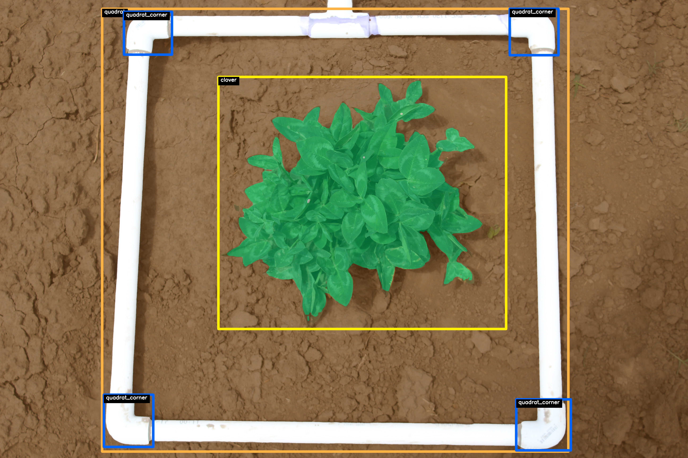
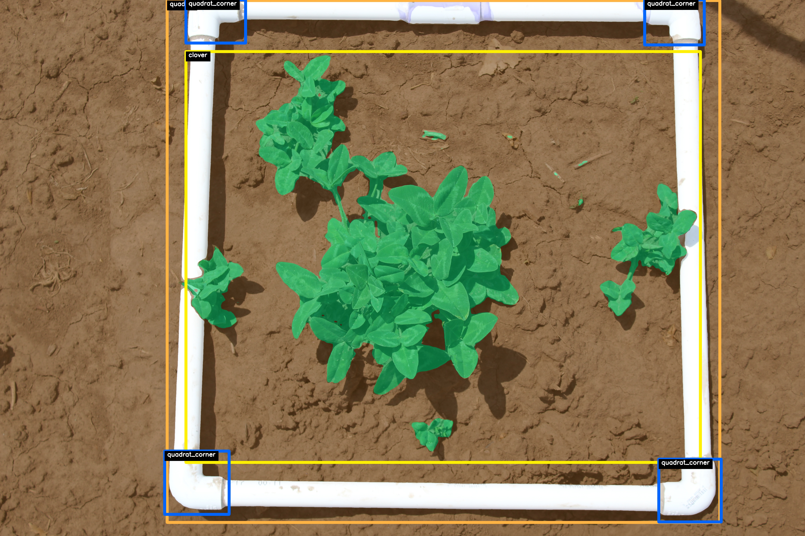
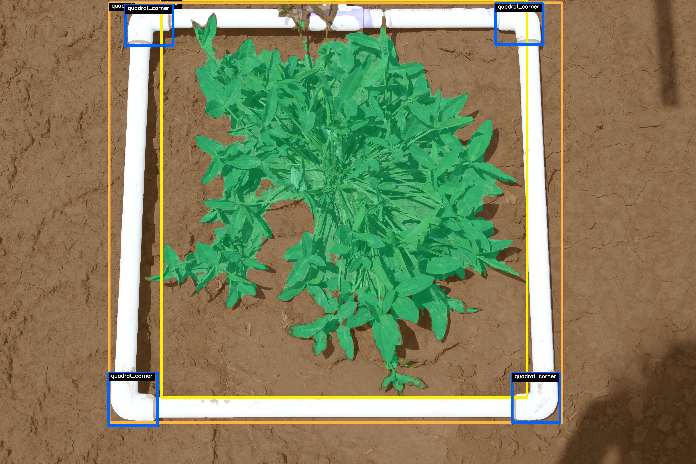

# K1702 Clover Analysis :four_leaf_clover:
## Semantic segmentation and object detection pipeline for analyzing images of field-grown Kura clover (Trifolium ambiguum L.) plants.
Authors
- [Bo Meyering](https://github.com/BoMeyering)
- [Mirza Sakiroglu](https://github.com/MirzaSakiroglu)

## Environment Setup
This project uses [uv](https://docs.astral.sh/uv/) to manage Python and dependencies. Install uv, then from the repo root:
```
$ uv sync
```
This creates `.venv/` with Python 3.12 and the exact versions pinned in `uv.lock`. PyTorch is installed from the CUDA 12.8 index (required for RTX 50xx / Blackwell GPUs).

Optional extras for the sub-pipelines:
```
$ uv sync --extra quadrat-detection   # EfficientDet / Lightning (src/quadrat_detection)
$ uv sync --extra mask-generation     # Segment Anything (src/mask_generation)
$ uv sync --all-extras                # everything
```
Add or remove dependencies with `uv add <pkg>` / `uv remove <pkg>` so `pyproject.toml` and `uv.lock` stay in sync.

## Training Scripts
Run scripts through uv (or activate `.venv` with `source .venv/bin/activate` and call `python` directly):
```
$ uv run train_object_detection_model.py
$ uv run train_segmentation_model.py
```
The top k=5 best model runs (based on the validation loss) will be stored in `checkpoints`.

## Semi-Supervised Training (FlexMatch on the HQ masks)
Tests how far 10 hand-drawn, high-quality masks go when every other image is used unlabeled. The code lives in `src/ssl/` and is ported from the `pgcview_v2_training_framework` FlexMatch trainer.

1. Download the finished Labelbox labels and rasterize them (kept separate from the SAM masks in `data/processed/targets`):
```
$ uv sync --all-extras
$ uv run scripts/download_labelbox_export.py   # needs LABELBOX_API_KEY -> data/raw/labelbox_hq/
$ uv run scripts/build_hq_targets.py           # -> data/processed_hq/targets/, classes in metadata/hq_target_mapping.json
```
2. Train FlexMatch and the supervised-only baseline (same labeled set, holdout, schedule and evaluation):
```
$ uv run torchrun --nproc_per_node=2 train_flexmatch.py -c configs/flexmatch_hq10.yaml
$ uv run torchrun --nproc_per_node=2 train_flexmatch.py -c configs/supervised_hq10.yaml
```
Any config value can be overridden on the command line, e.g. `training.epochs=5 wandb.mode=disabled`; without `torchrun` it runs on one GPU.

- **Labeled:** the HQ images minus `data.holdout_ids` (2 held out by default). **Unlabeled:** every other image (1,125).
- **Evaluation:** the HQ holdout (6 classes, EMA weights, scored at decoded resolution) and, every few epochs, agreement with the old SAM masks on the `val` split with predictions collapsed to soil/quadrat/clover. The SAM masks are never used as training targets; they are also used to score pseudo-label accuracy during training (logged as `train/pl_acc_*`).
- **Thresholds:** per-class FlexMatch thresholds from a running, DDP-synchronised learning status. `flexmatch.normalize: ratio` (default) measures each class's confidence relative to how often it is predicted, so rare-by-area classes like `clover_stems` are not treated as unlearned; `normalize: count` + `status: batch` reproduces the pgcview behaviour.
- Checkpoints (raw + EMA weights, FlexMatch state, config) go to `checkpoints/ssl/<run>/`; metrics, per-class thresholds and prediction panels go to wandb (`k1702_clover_ssl`).
## Dataset Overview :open_file_folder:
The Perennial Legumes Program at The Land Institute cultivated XXXX unique accessions from the USDA National Plant Germplasm System (NPGS) in the summer of 2017. Each plant was cultivated as a single plant plot. Plots were imaged with a Canon DLSR camera at least one time during the season. Clover plant were framed by a standard sampling quadrat constructed of 3/4" Schedule 40 PVC pipe with the following dimensions:
* OD (HxW) = 18"x18"
* ID (HxW) = 16.25"x16.25"

The annotated classes for object detection bounding boxes are:
```
{
  "clover": 1,
  "quadrat": 2,
  "quadrat_corner": 3
}
```
For the semantic segmentation masks we have the following classes:
```
{
  "soil": 0,
  "quadrat": 1,
  "clover": 3
}
```
The full dataset including the images, annotations, metadata, sampling strategy and training/validation splits are published in Zenodo and can be found at:

*Meyering et al* (2025). **K1702 - Kura Clover (Trifolium ambiguum) USDA Accession Image Dataset** [](https://doi.org/10.5281/zenodo.14051741)

## Project Workflow :repeat:
This project focuses on segmenting and analyzing Kura clover plants grown in the field. The goal is to develop computer vision models that can:
1. Detect and segment clover plants, and sampling quadrats from the soil background.
2. Detect and localize the corner PVC elbows on the sampling quadrat.
3. Compute the homology matrix between the image and the ROI bounded by the corners of the PVC quadrats.
4. Extract the kura clover contours from the standardized, prediction masks.
5. Calculate accession specific shape metrics such as solidity, canopy density, number of connected components, and fractal dimensions.
6. Rank accessions based on desired phenotypic traits and map to geographic origin.
7. Breeding values are computed for each accession based on shape/density metrics, enabling selection based on compactness, vigor, or spread.

## Model and Pipeline Development :computer:
### Deep Learning Models:
* Object Detection (Quadrat Corner Detection): We use an EfficientDet-based object detector to locate the four PVC quadrat corners using the Ross Wightman ```effdet``` library. [https://github.com/rwightman/efficientdet-pytorch](https://github.com/rwightman/efficientdet-pytorch)
* Semantic Segmentation (Plant/Soil/Quadrat): We will experiment with several different model architectures to segment kura clover from soil and quadrat background using the ```segmentation-models-pytorch``` [https://github.com/qubvel-org/segmentation_models.pytorch](https://github.com/qubvel-org/segmentation_models.pytorchlibrary).

### Geometric Correction
Detected quadrat corners are used to perform a perspective transform, warping the image to a standardized top-down view to correct for skew and perspective distortion.

### Feature Extraction
From the warped segmentation masks, we extract standardized shape and density features using:
* Shape descriptors (e.g., area, solidity, convexity)
* Connected components analysis,
* Family-wise density estimates.
* Breeding Value Computation
* Breeding values are computed for each accession based on shape/density metrics, enabling selection based on compactness, vigor, or spread.

## Example Images with Annotations 🖼️ 
### Accession Ta00070
Here is an example of one of the plants with a small but very dense canopy


### Accession Ta00079
In contrast, here is an example of a plant with several small, dense clustered canopies results from rhizomatous growth below the soil.


### Accesssion Ta00696
Finally, this accession exhibits uniformly sparse canopy, with most of the leaves growing at the margins of the plant.


## Feature Outputs 📊 
* From the warped masks, we compute:
* Total clover area
* Convex hull area
* Solidity (area / convex hull area)
* Number of clumps / components
* Average component size
* Edge distance metrics
* These metrics are used to evaluate morphological traits relevant to clover breeding (e.g., canopy density, spread, compactness).

## Downstream Applications 📈
Ranking accessions by morphological traits
Identifying breeding targets for canopy architecture
Estimating family-wise genetic effects (e.g., BLUPs)
Automating phenotyping pipelines for breeding trials

## Directory Structure 📁
```
data/
├── processed/
    ├── images/
    └── targets/
├── raw/
    ├── images/
    └── mat_files/
├── bboxes.csv
├── data_split.csv
├── plant_status.csv
└── SAM_points.csv
logs/
metadata/
├── obj_det_class_map.json
└── segmentation_class_map.json
outputs/
├── object_detection/
└──segmentation /
scripts/
src/
├── utils/
    ├── collate_functions.py
    └── loggers.py
├── callbacks.py
├── datasets.py
├── eval.py
├── metrics.py
├── models.py
├── trainer.py
└── transforms.py
.gitignore
LICENSE
README.md
pyproject.toml
uv.lock
train_object_detection_model.py
train_segmentation_model.py
```

## Tools & Technologies 🛠️ 
* [Labelbox](https://labelbox.com/): Image annotation
* [PyTorch](https://pytorch.org/): Model training
* [Albumentations](https://albumentations.ai/): Image augmentation
* [OpenCV](https://opencv.org/): Image warping and homography
* [NumPy](https://numpy.org/)
* [SciPy](https://scipy.org/): Connected components and shape analysis
* [Segment Anything (SAM)](https://segment-anything.com/): Prompt-based segmentation

## References 🔗 
* *Kirillov et al.* (2023). **Segment Anything** [DOI:10.48550/arXiv.2304.02643](https://doi.org/10.48550/arXiv.2304.02643)
* *Tan et al.* (2019). **EfficientDet: Scalable and Efficient Object Detection** [DOI:10.48550/arXiv.1911.09070](https://doi.org/10.48550/arXiv.1911.09070)
* *Chen et al.* (2017). **Rethinking Atrous Convolution for Semantic Image Segmentation** [DOI:10.48550/arXiv.1706.05587](https://doi.org/10.48550/arXiv.1706.05587)
* *Chen et al.* (2018). **Encoder-Decoder with Atrous Separable Convolution for Semantic Image Segmentation** [DOI:10.48550/arXiv.1802.02611](https://doi.org/10.48550/arXiv.1802.02611)
* *Xie et al.* (2021). **SegFormer: Simple and Efficient Design for Semantic Segmentation with Transformers** [DOI:10.48550/arXiv.2105.15203](https://doi.org/10.48550/arXiv.2105.15203)

## Acknowledgments 🤝
This work is part of our Kura clover breeding efforts at [The Land Institute](landinstitute.org). Many thanks to the field and lab teams who assisted in image collection and annotation.


